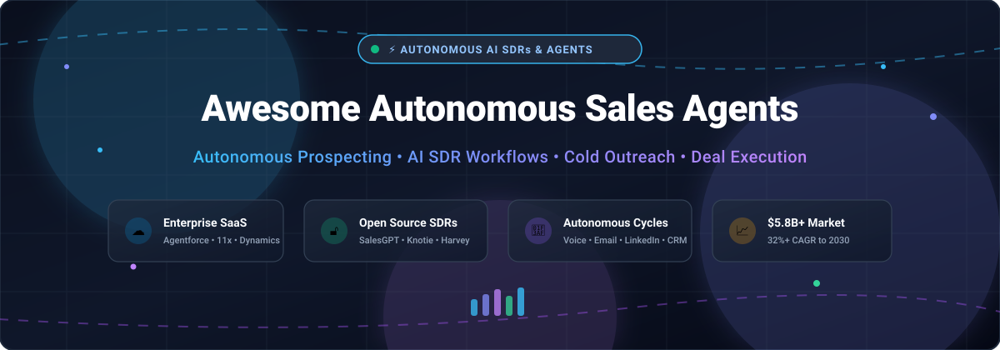

# Awesome-Autonomous-Sales-Agents

# Awesome-Autonomous-Sales-Agents 🤖 📈



  





  
  
  
  
  
  



---

## 🌟 Top Autonomous Sales Agents Ecosystem

**Curated List of Commercial AI SDR Platforms & Open-Source Sales Agent Frameworks**  
*Focused on Autonomous Prospecting, AI SDRs, Cold Outreach, Lead Qualification, Meeting Booking & Self-Hosted Sales Agents*

**Last updated: October 2026** 📅

---

### 📌 Overview & SEO Summary
Welcome to the ultimate curated directory of **autonomous sales agents**, **open-source AI SDR frameworks**, and **autonomous prospecting platforms**. Whether you are looking for enterprise-grade commercial solutions (such as *Salesforce Agentforce Sales*, *Artisan*, and *11x.ai*), or self-hostable open-source alternatives (like *OpenCloser*, *KiessClaw*, and *simple-sales-gpt*), this list covers category leaders, agentic architectures, and privacy-respecting sales automation.

**Key Market Context:**
- The AI SDR market grows from **$4.39B in 2025 to $5.81B in 2026** (32.3% CAGR), with **87% of sales organizations already using some form of AI** and nearly **90% planning to adopt AI agents by 2027** .
- **Salesforce Hunter** auto-learns how your sales team sells from connected customer, pipeline, and conversation data, then connects the right sales skills into a working plan that runs alongside reps. It ships in **Coworker** with out-of-the-box and customizable prospecting skills .
- **Salesforce Agentforce Sales** requires **Enterprise Edition ($165/user/month)** as a minimum, with the add-on license at **$125/user/month** or the **Agentforce 1 Sales edition at $550/user/month** .
- **Microsoft Dynamics 365 Sales** includes out-of-the-box AI agents: **Sales Qualification Agent** (autonomously researches leads, determines fit, sends outreach), **Sales Opportunity Agent** (researches opportunities, surfaces risks), and **Sales Close Agent** (manages end-to-end sales cycle autonomously) .
- **OpenCloser** is the **most complete open-source AI SDR & sales platform** — AI Sales Strategist (SPIN & Challenger frameworks), AI Lead Researcher, AI Caller (real-time voice with Twilio), AI Sales Coach (objection sparring), and AI Sales Manager (post-call debrief) — all running locally with **zero cloud dependency** at **$0 vs $280–$1,000+/month per seat** for SaaS alternatives .
- **KiessClaw** is a **CLI-first multi-agent sales framework** with 10 specialized agents (KiessProspector, KiessSequencer, KiessPen, KiessInbox, KiessMetrics, plus SEO agents), sharing a **markdown-based workspace brain** where context persists across agent runs .
- **SquadStack.ai** introduced **outcome-based pricing** for voice AI sales agents in India — customers pay based on **revenue generated** (loans disbursed, cards issued) rather than call minutes, with **93% of proofs of concept converting to production vs ~25% industry average** .
- **SaaStr replaced its human SDR team with 20+ AI agents** that sent **60,000+ personalized emails and booked 130+ meetings**, though each agent took **two weeks minimum to deploy** and every message was human-reviewed for the first 30 days .

---

## 📑 Table of Contents
- [🏢 SaaS & Commercial Platforms](#-saas--commercial-platforms)
- [🔓 Open-Source GitHub Projects](#-open-source-github-projects)
- [🛠️ How to Contribute](#%EF%B8%8F-how-to-contribute)
- [📊 Star History](#-star-history)
- [🤝 Support & Sponsorship](#-support--sponsorship)
- [⚠️ Disclaimer](#%EF%B8%8F-disclaimer)

---

## 🏢 SaaS / Commercial Platforms

The autonomous sales agent market spans **CRM-native sales agents** (Salesforce Agentforce Sales, Microsoft Dynamics 365 Sales) that integrate **deeply with CRM data and workflows**, **AI-native SDR platforms** (Artisan, 11x.ai, AiSDR) that **autonomously prospect, personalize, and book meetings**, and **sales engagement platforms** (Regie.ai, Reply.io, Outreach) that **augment human reps with AI-powered sequencing and conversation intelligence**. **Salesforce Agentforce Sales** requires **Enterprise Edition ($165/user/month) as a minimum**, with the add-on at **$125/user/month** or the **Agentforce 1 Sales bundle at $550/user/month** . **Microsoft Dynamics 365 Sales** includes multiple autonomous agents for qualification, opportunity research, and deal closure .

| SaaS / Commercial Platform | Company / Owner | Valuation / Market Cap | Standard Edition Starting Price | Free Tier / Free Trial Limits | Description |
| :--- | :--- | :--- | :--- | :--- | :--- |
| **[Salesforce Agentforce Sales](https://www.salesforce.com/sales/ai-sales-agent/)** ☁️ | Salesforce | ~$250 Billion | **$125/user/month** (add-on) or **$550/user/month** (Agentforce 1 Sales) | **Free: Foundations tier with Flex Credits** | **CRM-native autonomous sales** — **Hunter auto-learns how your team sells from connected customer, pipeline, and conversation data** . **Agentforce 1 Sales bundle includes Data 360, Flex Credits, and full agent usage**. **Requires Enterprise Edition ($165/user/month) or above — no workaround** . **Siemens deployed Agentforce to engage 100% of 2,500+ monthly inbound leads across 132 countries** . |
| **[Microsoft Dynamics 365 Sales](https://dynamics.microsoft.com/en-us/sales/)** 🔷 | Microsoft | ~$3.90 Trillion | **$65/user/month** (Professional); **$135/user/month** (Enterprise) | **Free trial available** | **Microsoft-native autonomous sales** — **Sales Qualification Agent** autonomously researches leads, determines fit, sends outreach . **Sales Opportunity Agent** surfaces emerging risks and promising opportunities. **Sales Close Agent** manages end-to-end sales cycle autonomously, engages customers, recommends products, handles objections, and drives transactions to closure . **Sales Development agent works 24/7 generating qualified opportunities from leads** . |
| **[11x.ai](https://www.11x.ai/)** 🎯 | 11x | Private | **Custom enterprise pricing** (not published) | **Live demo required** | **Fully autonomous outbound AI SDR** — **Alice (AI Outbound Sales Agent)** does expert-level research and crafts deeply personalized outreach sequences. **Julian (AI Phone Agent)** responds in seconds to demo requests, qualifying, answering questions, and booking meetings instantly across voice, chat, SMS, and WhatsApp. **Expensive relative to alternatives; still relies on cold data and list quality**. |
| **[Artisan](https://www.artisan.co/)** 🏭 | Artisan | ~$36M raised | **Custom pricing** (not published) | **Demo available** | **All-in-one outbound AI SDR** — **Ava 2.0 runs full outbound end-to-end**: identifying and researching prospects, writing 1:1 outreach based on deep research, running email sequences, handling replies including objections, and booking meetings. **SOC 2 Type II audited, SSO, RBAC, and guardrails**. **Largest single deployment runs Ava across 1,000+ reps at SumUp** . |
| **[AiSDR](https://aisdr.com/)** 🚀 | AiSDR | Private | **$250/month** (Solo, 200 contacts) | **Free trial available** | **Simplified outbound AI SDR** — **Easy onboarding, multi-channel execution, clear pricing model**. **Deeper Salesforce integration than bidirectional contact sync** — every email, reply, and meeting recorded on Contact and Account timelines. **AI account scoring against 1-4 custom criteria**. **Less advanced than category leaders; limited depth in customization**. |
| **[Regie.ai](https://www.regie.ai/)** ⚙️ | Regie.ai | Private | **$41/month** (Pro, annual, 5,000 credits) | **Free: 250 one-time credits** | **AI sales engagement platform** — **Orchestrates plays across channels with AI Agents doing the heavy lifting**. **Strong copy generation, improved personalization quality, quick campaign setup**. **Limited autonomy; does not handle full SDR workflow**. |
| **[Conversica](https://www.conversica.com/)** 🟢 | Conversica | Private | **Custom enterprise pricing** | **Demo available** | **AI sales assistant for lead engagement** — **AnswersIQ leverages RAG for accurate, consistent, real-time responses across SMS and email**. **Fact collection from websites and uploaded documents**. **Automates lead follow-ups and re-engages prospects**. |
| **[Lavender](https://www.lavender.ai/)** 💜 | Lavender | Private | **Custom pricing** | **Free trial available** | **AI sales email coach** — **Grades emails and gives tips to improve**. **Reply rates increase 2-3x when emails score 90 or above**. **Personalization Assistant brings prospect data directly to inbox**. **SOC 2 & GDPR certified**. |
| **[Reply.io Jason AI](https://reply.io/)** ⚡ | Reply.io | Private | **Custom pricing** | **Free trial available** | **Self-learning AI SDR** — **Jason 4.5 watches what you edit and turns repeated changes into AI Learnings applied automatically**. **Custom Playbook builds sales strategy from offer, ICP, and business context**. **LinkedIn Intent Signals** tracks prospects engaging with relevant content. **Calendly booking on autopilot**. |
| **[Outreach Kaia](https://www.outreach.ai/)** 📞 | Outreach | Private | **Custom enterprise pricing** | **Demo available** | **AI conversation intelligence** — **Built on Outreach's AI Revenue Workflow architecture**, sharing data with Omni, Deal Agent, and Research Agent. **Coach Cards score meetings against your team's criteria**. **Conversation data flows into CRM field updates and deal summaries**. |
| **[SquadStack.ai](https://www.squadstack.ai/)** 🇮🇳 | SquadStack | Private | **Outcome-based pricing** (fixed base + success fee) | **Live in banking/financial services** | **Voice AI sales agents with outcome-based pricing** — **Customers pay based on revenue generated, not call minutes** . **93% of proofs of concept convert to production vs ~25% industry average**. **DMI Finance disbursed ₹700 crore with 30% higher conversions than human agents**. **BankBazaar halved customer acquisition cost across 8 crore leads**. |

---

## 🔓 Open-Source GitHub Projects

*Sorted by GitHub_Stars_Count (Descending)* 🌟

- **[OpenCloser](https://github.com/issacops/opencloser)**   
  **Open-source AI SDR & AI sales platform**, MIT licensed. **The most complete open-source AI sales team** — **AI Sales Strategist generates ICP using SPIN & Challenger frameworks** . **AI Lead Researcher does autonomous lead hunting with scoring and qualification, full local-first CRM with Kanban pipeline**. **AI Caller (SDR) is a real-time AI voice agent** powered by Google Gemini (also supports OpenAI Realtime and ElevenLabs ConvAI) with **built-in Twilio phone lines, live transcription, sentiment analysis, objection detection, and power dialing**. **AI Sales Coach offers objection sparring training with 3 difficulty levels and 12 objection archetypes**. **AI Sales Manager does post-call debrief with auto-generated follow-up emails and call analytics**. **Runs fully in demo mode with no API key** — 10 realistic seed leads, simulated AI calls. **Built with Tauri, React 19, Rust, and Gemini**. **Cost: Free vs $280–$1,000+/month per seat for SaaS alternatives** . 🚀

- **[KiessClaw](https://github.com/monykiss/kiessclaw)**   
  **CLI-first multi-agent sales framework**, open-source. **10 specialized agents sharing one workspace brain** — **KiessProspector** (lead import, enrichment, ICP scoring), **KiessSequencer** (sequence orchestration, scheduling, safety), **KiessPen** (personalization, first lines, templates), **KiessInbox** (reply classification, qualification, DNC), **KiessMetrics** (analytics, deliverability, reporting), plus 5 SEO agents . **Markdown-based memory system** where context persists across agent runs. **Use Case Registry with 6 built-in workflows**, **Prompt Factory with deterministic prompts**, **Prompt Linting**, **Code Scaffolding**, and **Doctor Command** for diagnostics. **Python 3.10+, OpenAI/Anthropic/Ollama support, Slack notifications, Docker deployment** . 🛠️

- **[simple-sales-gpt](https://github.com/BOFOII/simple-sales-gpt)**   
  **Modular Go package for building sales conversation agents**, MIT licensed. **One agent session per conversation** with **shared knowledge base for products, promotions, and vector search** . **Configurable LLM model** — core package does not hardcode a model provider. **Configurable vector store** — Chroma, Milvus, Pinecone, or any LangChainGo-compatible store. **Tool registry with named tools, descriptions, parameters, and handlers**. **Conversation stages and interest levels**. **Step-based execution for reasoning, tool selection, tool execution, and final response generation** . 🎯

- **[ShampooSalesAgent](https://github.com/jackfsuia/ShampooSalesAgent)**   
  **Minimal LLM sales agent framework for fast deployment and benchmark**, open-source. **20 GitHub stars** — **supports OpenAI models, Claude, HuggingFace models, Gemini, Ernie (文心一言4.0), Baichuan (百川), Qwen (通义千问), Moonshot (月之暗面), GLM (智谱), and Deepseek** . **The most accessible open-source sales agent for multi-model experimentation**. 🧪

---

## 🛠️ How to Contribute

Contributions are welcome! Follow these steps to submit new autonomous sales agent platforms or open-source sales automation software:

1. 🍴 **Fork** the repository.
2. 📝 **Add/edit** entries in `README.md` maintaining table/list structure and formatting.
3. 🔗 Include project title, official website/GitHub link, exact Stars_Count, license, and brief description.
4. 🚀 Submit a **Pull Request** with a descriptive summary of your changes.

---

## 📊 Star History



---

## 🤝 Support & Sponsorship

If you find this autonomous sales agents repository useful, please consider supporting the project:

- ⭐ **Star** this repository to increase visibility!
- 🔀 **Fork** and share with fellow sales leaders, RevOps professionals, and open-source advocates.
- ☕ **Sponsor & Buy Me a Coffee**: Support ongoing open-source curation via the [GitHub Sponsor Dashboard](https://github.com/sponsors/ishandutta2007).

---

## ⚠️ Disclaimer

- This is a **community-curated** list — not exhaustive and not an endorsement. ℹ️
- **Salesforce Agentforce Sales requires Enterprise Edition ($165/user/month) as a minimum** — **Agentforce does not run on Professional Edition, and there is no workaround** . **The add-on license costs $125/user/month, or $550/user/month for the bundled Agentforce 1 Sales edition** .
- **Microsoft Dynamics 365 Sales includes multiple autonomous agents** — **Sales Qualification Agent, Sales Opportunity Agent, Sales Close Agent, Sales Research Agent, and Recommended Actions Agent** . **Sales Development agent works 24/7 generating qualified opportunities from leads and can engage in two-way conversations** .
- **AI SDRs are not a plug-in replacement for human SDRs** — **88% of AI SDR pilots stall before production**, usually from treating it as a plug-in rather than an operated system. **Teams that persist see output rise 363% by month six** . **The stable end-state is a 70/30 AI-to-human workload split** .
- **Open-source sales agent frameworks are not turnkey** — **OpenCloser requires Node.js v20+, Rust, and Tauri prerequisites** . **KiessClaw requires Python 3.10+ and an OpenAI/Anthropic/Ollama API key** . **simple-sales-gpt requires Go, LangChainGo, and a vector store** . **Always validate outreach quality, deliverability, and CRM data hygiene with a proof-of-concept** before production deployment. 📈

---



  <b>Made with ❤️ for sales leaders, RevOps professionals, and open-source AI sales advocates.</b>

